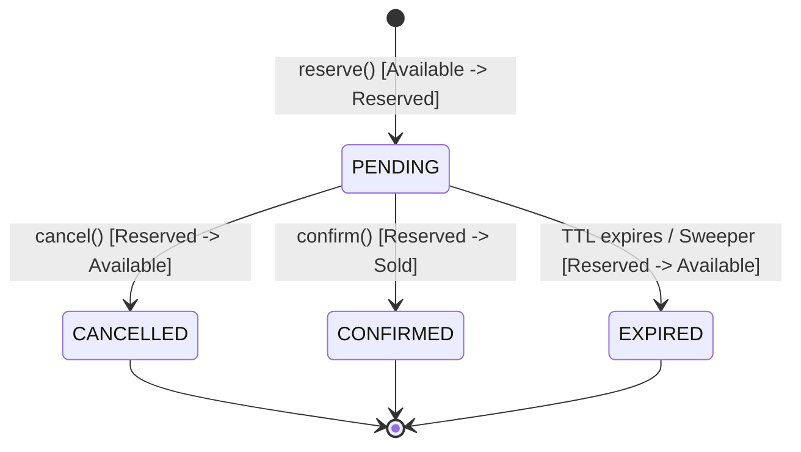

# ⚡ Flash Sale Overselling Prevention Engine

A production-grade, thread-safe inventory management engine designed to **prevent overselling during high-concurrency flash sales**, enforce per-user purchase limits, manage TTL-based temporary holds, and maintain real-time inventory invariants.

---

## 🎯 System Objectives & Milestones (M1 – M5)

| Requirement | Implementation Detail | Location |
| :--- | :--- | :--- |
| **M1: Inventory Loading** | Loads product metadata, initial stock, prices, and per-user limits from JSON or dictionaries with strict schema validation. | [`engine.py`](file:///flash_sale/engine.py), [`inventory.json`](file:///inventory.json) |
| **M2: Stock Reservation & TTL** | Atomically claims stock into `reserved` status for a configurable TTL (default: 120s). Returns a unique reservation handle. | [`engine.py::reserve`](file:///flash_sale/engine.py), [`sweeper.py`](file:///flash_sale/sweeper.py) |
| **M3: Confirmation / Cancellation / Expiry** | `confirm` permanently deducts stock into `sold`. `cancel` releases stock to `available`. Expired reservations automatically return stock. | [`engine.py::confirm`](file:///flash_sale/engine.py), [`engine.py::cancel`](file:///flash_sale/engine.py) |
| **M4: Per-User Purchase Limits** | Tracks active reservations + confirmed purchases per user per SKU. Rejects requests exceeding quota and restores allowance upon cancel/expiry. | [`limiter.py`](file:///flash_sale/limiter.py) |
| **M5: Real-Time Reporting** | Reports `available`, `reserved`, and `sold` counts per SKU. Strictly validates the invariant: `initial_stock == available + reserved + sold`. | [`engine.py::get_stock_report`](file:///flash_sale/engine.py), [`models.py`](file:///flash_sale/models.py) |

---

## 📐 Architecture & State Flow

```
                      +-------------------+
                      |   inventory.json  |
                      +---------+---------+
                                |
                                v
                     +---------------------+
                     |   FlashSaleEngine   |
                     +----------+----------+
                                |
           +--------------------+--------------------+
           |                    |                    |
           v                    v                    v
  +------------------+  +------------------+  +------------------+
  |  Per-SKU RLock   |  |   User Limiter   |  |   Min-Heap TTL   |
  | (Zero Oversell)  |  |  (Quota Manager) |  |     Sweeper      |
  +------------------+  +------------------+  +------------------+
```

### Reservation Lifecycle State Machine



---

## 🚀 Quickstart & Runnability

### 1. Requirements
- Python 3.10+ (Standard library only; **zero external dependencies required for the engine**)
- `pytest` (optional, for running pytest suite)

### 2. Run the Live Flash Sale Simulation
A multi-threaded flash sale simulation demonstrating 40 concurrent buyers competing for 5 units of stock:

```bash
python run_demo.py
```

### 3. Run Automated Tests

**Run with pytest (recommended):**
```bash
pytest -v
```

**Run with Python standard library `unittest` (zero dependencies):**
```bash
python -m unittest discover tests -v
```

All 38 test suites (59 test cases and assertions) execute in under **0.25 seconds**.

---

## 🛡️ Concurrency & Preventing Overselling

High-traffic flash sales suffer from race conditions when dozens or hundreds of requests hit the same SKU at the same millisecond.

### 1. Fine-Grained Per-SKU Locks (`threading.RLock`)
- Rather than a coarse global lock that creates bottleneck serialization across unrelated items, the engine uses **per-SKU reentrant locks**.
- High contention on `MACBOOK-AIR-M3` does not block users purchasing `PS5-SLIM`.
- Stock reads and mutations (`available_stock -= qty`, `reserved_stock += qty`) occur atomically inside the locked critical section.

### 2. Strict Mathematical Invariant
At all times, across every transaction and state change:
$$\text{initial\_stock} = \text{available} + \text{reserved} + \text{sold}$$
Any violation immediately triggers an assertion failure.

### 3. Dual Expiration Guarantee (Passive + Active Sweeper)
- **Active Background Sweeper**: Uses a **Min-Heap ($O(\log N)$ priority queue)** running in a lightweight daemon thread to pop and expire reservations as soon as their TTL passes.
- **Passive On-Demand Expiry**: When an item is accessed, queried, or confirmed, the engine lazily checks if `time.time() >= reservation.expires_at`. This eliminates race windows even if background timers jitter.

---

## 🔍 Edge Cases Addressed

| Edge Case | Behavior / Mitigation |
| :--- | :--- |
| **Negative / Float / Zero Quantities** | Rejected at input validation (`ValidationError`). |
| **User ID Spoofing / Access Control** | User A cannot confirm or cancel User B's reservation (`ReservationNotFoundError`). |
| **Duplicate Confirmation** | Double `confirm()` calls rejected (`InvalidStateError`). |
| **Cancellation After Expiry** | Expired reservations cannot be cancelled (`InvalidStateError`). |
| **Confirmation After Expiry** | Expired reservations cannot be confirmed; stock is automatically freed (`ReservationExpiredError`). |
| **Quota Exhaustion via Multiple Orders** | Limiter calculates $\text{active\_reserved} + \text{confirmed\_purchased} + \text{requested} \le \text{limit}$. |
| **Quota Restoration** | Cancelling or expiring a reservation immediately restores available purchasing quota for that user. |
| **Total Stock Depletion to 0** | Available hits 0; subsequent requests fail cleanly with `InsufficientStockError`; stock restores upon cancellation or expiry. |

---

## 🎁 Stretch & Bonus Features

### 1. FIFO Waitlist with Auto-Promotion
- When stock reaches 0, buyers can join a fair FIFO queue (`engine.join_waitlist(user_id, sku, qty)`).
- When an active reservation is cancelled or expires, the engine automatically allocates freed stock to the next eligible user in the waitlist!

### 2. Comprehensive Audit Ledger
- An immutable transaction ledger (`AuditLedger`) records every event (`INVENTORY_LOADED`, `RESERVATION_CREATED`, `RESERVATION_CONFIRMED`, `RESERVATION_CANCELLED`, `RESERVATION_EXPIRED`, `WAITLIST_PROMOTED`) with timestamps and user IDs.

### 3. Interactive CLI & Simulation Harness
- [`flash_sale/cli.py`](file:///flash_sale/cli.py) provides a simulation runner with formatted tabular reports and live metrics.

---

## 📁 Repository Structure

```
submissions/akshatjain-93/
├── inventory.json          # Sample product catalog and stock levels
├── run_demo.py             # One-click runnable demonstration
├── requirements.txt        # Optional test runner dependencies
├── README.md               # Architecture, run instructions, and design
├── PROMPTS.md              # AI collaboration log and architectural decisions
├── flash_sale/             # Core engine package
│   ├── __init__.py         # Package exports
│   ├── engine.py           # FlashSaleEngine core controller
│   ├── models.py           # Dataclasses (Product, Reservation, StockReport)
│   ├── exceptions.py       # Domain-specific exceptions
│   ├── limiter.py          # Per-user quota manager
│   ├── sweeper.py          # Min-heap TTL scheduler & daemon thread
│   ├── waitlist.py         # FIFO waitlist with auto-promotion (Bonus)
│   ├── audit.py            # Event ledger for auditability (Bonus)
│   └── cli.py              # CLI simulation runner
└── tests/                  # Exhaustive automated test suite
    ├── __init__.py
    ├── test_engine.py      # M1 - M5 functional tests (20 tests)
    ├── test_concurrency.py # High-concurrency race condition tests (3 tests)
    ├── test_edge_cases.py  # Input sanitization and robustness (13 tests)
    └── test_waitlist.py    # Waitlist and auto-promotion tests (2 tests)
```

---

## 💻 Python API Usage Example

```python
from flash_sale import FlashSaleEngine

# Initialize with sample inventory
engine = FlashSaleEngine(inventory_source="inventory.json", default_ttl=120)

# M2: Reserve stock (holds for 120s TTL)
reservation = engine.reserve(user_id="alice", sku="IPHONE-15-PRO", quantity=1)
print(f"Reserved: {reservation.reservation_id}, expires at {reservation.expires_at}")

# M5: Check stock status
report = engine.get_stock_report("IPHONE-15-PRO")
print(f"Available: {report.available}, Reserved: {report.reserved}, Sold: {report.sold}")

# M3: Confirm order permanently
confirmed = engine.confirm(reservation.reservation_id, user_id="alice")
print(f"Order confirmed! Status: {confirmed.status.value}")

# Clean shutdown of sweeper thread
engine.shutdown()
```

