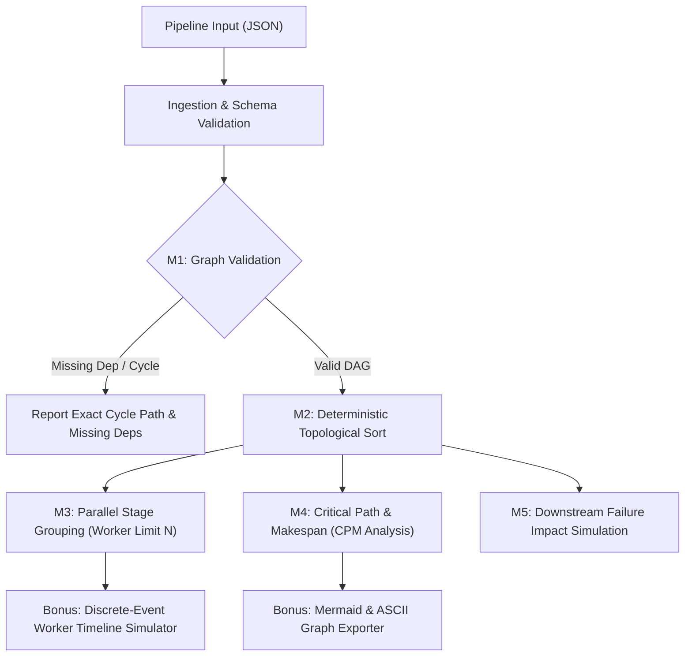

# SDSI Agentic AI Hackathon — PS5: Job Scheduler with Dependency Resolution (DAG)

**Track:** Developer Track  
**Submission Alias:** `raj-588`  
**Use Case:** PS5 — Mini Build & ETL Orchestrator with DAG Dependency Resolution  

---

## 1. Executive Summary & Architecture

This solution provides a production-grade, zero-dependency DAG orchestrator and job scheduler. It solves pipeline dependency resolution, concurrency scheduling under worker constraints, critical path analysis, and failure impact propagation.



---

## 2. Milestone Capabilities (M1 – M5)

### **M1: Graph Validation & Cycle Detection**
- **Cycle Detection**: Employs a 3-color Depth First Search (WHITE=unvisited, GRAY=active in stack, BLACK=finished). When a GRAY node is encountered, the exact cycle path (e.g. `job_a -> job_b -> job_c -> job_a`) is extracted and reported.
- **Missing Dependencies**: Detects and reports any job referenced in `dependsOn` that does not exist in the graph, citing both the missing dependency and all dependent jobs.
- **Complexity**: $O(V + E)$ time, $O(V)$ auxiliary space.

### **M2: Valid Execution Order (Topological Sort)**
- Implements **Kahn's Algorithm** with an in-degree tracking table.
- Employs deterministic min-heap tie-breaking (lexicographical) so that execution orders are 100% reproducible across test runs.
- Guarantees: For every job $u$, all predecessors in `dependsOn` precede $u$ in the output.
- **Complexity**: $O(V + E \log V)$ time.

### **M3: Parallel Stages with Configurable Worker Limit $N$**
- **Logical Staging**: Calculates graph levels (longest hop distance from any root). Jobs in the same level are guaranteed to be mutually independent.
- **Worker Concurrency Limit $N$**: If a level contains more than $N$ ready jobs, the level is automatically batched into parallel stages of size $\le N$.
- **Edge cases handled**: $N=1$ (sequential), $N \ge V$ (unbounded parallelism), invalid/non-integer worker counts.

### **M4: Critical Path & Minimum Total Completion Time (Makespan)**
- Implements the classic **Critical Path Method (CPM)**:
  - **Forward Pass**: Computes Earliest Start ($ES$) and Earliest Finish ($EF$) times.
  - **Backward Pass**: Computes Latest Start ($LS$) and Latest Finish ($LF$) times.
  - **Slack (Float) Calculation**: $\text{Slack} = LS - ES$.
  - **Critical Path Identification**: Jobs with zero slack form the critical path.
- Reports total unconstrained makespan: $\max_{u \in V} EF(u)$.

### **M5: Failure Simulation**
- Given a failed job $X$:
  - Uses breadth-first search on forward adjacency edges to compute the full transitive closure of downstream dependent jobs.
  - Partitions graph into **Skipped Jobs** (all downstream dependents) and **Executed/Runnable Jobs** (unaffected branches).
  - Calculates percentage blast radius / impact metrics.

---

## 3. Stretch & Bonus Features

1. **Discrete-Event Worker-Pool Simulator (`orchestrator.py run -w N`)**:
   - Truly simulates a multi-worker pool over time using an event-driven priority queue.
   - Outputs a Gantt-style execution timeline and calculates real worker-constrained makespan.
2. **Mermaid Graph Exporter (`orchestrator.py mermaid`)**:
   - Exports the graph into Mermaid markdown syntax with critical path nodes and edges highlighted.
3. **Hackathon Agent Wrapper (`agent.py`)**:
   - Extends `agent-template/agent.py` conforming to `run(task: str) -> dict`.
   - Incorporates Human-in-the-Loop (HITL) gates:
     - Escalates if cycles or broken dependencies are found.
     - Escalates if a simulated failure causes $>50\%$ pipeline disruption.
     - Intercepts and blocks adversarial prompt injection attempts.

---

## 4. Edge Cases & Robustness Matrix

| Scenario / Edge Case | Handled Behavior | Tested In |
|---|---|---|
| **Empty Graph `[]`** | Returns empty schedule, 0 makespan, valid report | `test_empty_graph` |
| **Self-Referential Cycle ($A \to A$)** | Pinpoints `["A", "A"]` cycle immediately | `test_self_cycle_detected` |
| **Deep / Multi-node Cycle** | Returns exact loop slice `[A, B, C, A]` | `test_multi_node_cycle_exact_path` |
| **Disconnected DAGs / Forest** | Accurately identifies critical path across components | `test_disconnected_subgraphs_makespan` |
| **Zero Duration Jobs** | Handled seamlessly without division or timing bugs | `test_zero_duration_jobs` |
| **Negative Duration** | Strict validation error raised | `test_negative_duration_rejected` |
| **Duplicate Job IDs** | Detected and rejected at ingestion | `test_duplicate_job_id_rejected` |
| **Null-Byte Injection (`\x00`)** | Intercepted during ID sanitization | `test_null_byte_sanitization` |
| **Malformed JSON** | Clean error with line & column info | `test_malformed_json_handling` |
| **Leaf Job Failure** | 0 downstream skipped, remaining executed | `test_failure_at_leaf` |
| **Non-existent Job Failure** | Validated and cleanly rejected | `test_nonexistent_job_failure_raises` |

---

## 5. Quickstart & Verification

All code uses the Python standard library with **zero external dependencies**.

### Running the Test Suite
```bash
python test_scheduler.py
```
*(Runs 26 comprehensive unit tests covering M1-M5, edge cases, and security).*

### Running CLI Commands
```bash
# M1: Validate DAG (detects cycles and missing dependencies)
python orchestrator.py validate -f sample_data/pipeline_complex_etl.json

# M2: Topological Sort execution order
python orchestrator.py plan -f sample_data/pipeline_complex_etl.json

# M3: Parallel stages with worker limit N=2
python orchestrator.py stages -f sample_data/pipeline_complex_etl.json -w 2

# M4: Critical path and makespan
python orchestrator.py critical-path -f sample_data/pipeline_complex_etl.json

# M5: Simulate failure of job 'clean_billing'
python orchestrator.py simulate-failure -f sample_data/pipeline_complex_etl.json --fail-job clean_billing

# Bonus: Discrete-event execution simulation
python orchestrator.py run -f sample_data/pipeline_complex_etl.json -w 2

# Output machine-readable JSON:
python orchestrator.py critical-path -f sample_data/pipeline_complex_etl.json --json
```

### Agent Scaffold Execution
```bash
python agent.py
```
Conforms directly to the hackathon evaluator contract:
```python
{"plan": [...], "result": {...}, "escalated": False}
```
