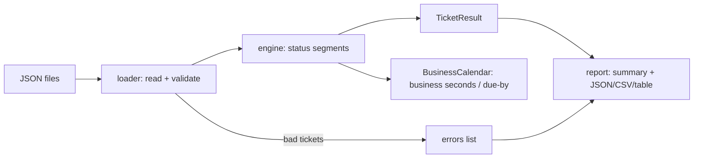

# PS6 — IT Service-Desk SLA Tracker

Computes **business-hours SLA compliance** for service-desk tickets: elapsed
business minutes, due-by time, breach flag and breach minutes per ticket, plus
breach % per priority and per assignee group.

- **Zero dependencies** — Python 3.11+ standard library only (smaller attack surface, nothing to install).
- **86 unit tests**, runs in < 1 s.
- Deterministic, point-in-time evaluation via `--as-of`.

---

## Quick start

```bash
cd submissions/varuns004

# Human-readable report on the bundled sample data
python -m sla_tracker \
  --tickets sample_data/tickets.json \
  --policy sample_data/sla_policy.json \
  --holidays sample_data/holidays.json \
  --as-of 2026-10-16T18:00:00+05:30

# Machine-readable output
python -m sla_tracker ... --format json --output report.json
python -m sla_tracker ... --format csv  --output report.csv

# Run the tests
python -m unittest discover -s tests -t .
```

Optional install as a command: `pip install .` then `sla-tracker --help`.

### CLI options

| Option | Description |
|---|---|
| `--tickets PATH` | Tickets JSON (required) |
| `--policy PATH` | SLA policy JSON (required) |
| `--holidays PATH` | Holidays JSON (optional) |
| `--as-of TS` | Evaluation instant, ISO-8601. Default: now. Open tickets are measured up to this time. |
| `--format` | `table` (default), `json`, `csv` |
| `--output PATH` | Write to file instead of stdout |
| `--fail-on-breach` | Exit `1` if any ticket breached (CI / cron alerting) |
| `--strict` | Exit `2` if any ticket was rejected by validation |
| `-v` | Debug logging to stderr |

**Exit codes:** `0` OK · `1` breaches found (with `--fail-on-breach`) · `2` invalid input/config.

---

## Requirements coverage

| # | Requirement | Where / how |
|---|---|---|
| M1 | Targets P1=4h, P2=8h, P3=24h, P4=72h in business hours (Mon–Fri 09:00–18:00) | `sla_policy.json` (same values are built-in defaults); `business_calendar.py` |
| M2 | Exclude holidays | `holidays.json` → `BusinessCalendar.is_business_day` |
| M3 | Pause clock while `ON_HOLD` | `engine.build_segments` splits the timeline by status; only *running* segments count |
| M4 | Per ticket: elapsed business minutes, due-by, breached, breach minutes | `TicketResult.to_dict` |
| M5 | Breach % per priority and per assignee group | `report.summarize` |

### Bonus features
- **At-risk detection** — open tickets that have used ≥ 80 % (configurable `at_risk_ratio`) of their target.
- **`remaining_minutes` and `on_hold_business_minutes`** per ticket; **`avg_elapsed_business_minutes`**, open and at-risk counts in summaries.
- **Reopen support** — `RESOLVED → REOPENED` resumes the clock.
- **Configurable everything** — timezone, business hours, working days, priorities/targets, status classification.
- **Point-in-time replay** — events after `--as-of` are ignored, so you can ask "what did the SLA board look like last Friday?".
- **Three output formats** + CI-friendly exit codes.

---

## Input formats

**`sla_policy.json`** (every field optional; defaults shown)
```json
{
  "timezone": "+05:30",
  "business_hours": { "start": "09:00", "end": "18:00" },
  "working_days": ["MON", "TUE", "WED", "THU", "FRI"],
  "targets_hours": { "P1": 4, "P2": 8, "P3": 24, "P4": 72 },
  "running_statuses": ["NEW", "OPEN", "ASSIGNED", "IN_PROGRESS", "REOPENED"],
  "paused_statuses": ["ON_HOLD"],
  "stopped_statuses": ["RESOLVED", "CLOSED"],
  "at_risk_ratio": 0.8
}
```
`timezone` accepts `UTC`, a fixed offset (`+05:30`) or an IANA name (`Asia/Kolkata`; needs `pip install tzdata` on Windows). The default when the field is omitted is `UTC`.

**`holidays.json`** — `["2026-10-02", ...]` or `{"holidays": [{"date": "2026-10-02", "name": "..."}]}`.

**`tickets.json`** — a list or `{"tickets": [...]}`:
```json
{
  "id": "INC-1003", "priority": "P2", "assignee_group": "Desktop",
  "created_at": "2026-10-09T10:00:00+05:30",
  "status_history": [
    { "status": "ON_HOLD",     "at": "2026-10-09T12:00:00+05:30" },
    { "status": "IN_PROGRESS", "at": "2026-10-12T14:00:00+05:30" },
    { "status": "RESOLVED",    "at": "2026-10-13T15:00:00+05:30" }
  ]
}
```

## Output (per ticket, JSON)
```json
{
  "ticket_id": "INC-1003", "priority": "P2", "assignee_group": "Desktop",
  "current_status": "RESOLVED", "clock_state": "STOPPED",
  "target_minutes": 480, "elapsed_business_minutes": 720,
  "on_hold_business_minutes": 120, "remaining_minutes": 0,
  "due_by": "2026-10-13T11:00:00+05:30",
  "breached": true, "breach_minutes": 240, "at_risk": false
}
```

---

## Design



| Module | Responsibility |
|---|---|
| `models.py` | Immutable dataclasses (`Ticket`, `SlaPolicy`, `TicketResult`) and error types |
| `timeutil.py` | Timezone and ISO-8601 parsing (the only place timezones are handled) |
| `business_calendar.py` | Pure business-time arithmetic: `business_seconds(a, b)`, `add_business_seconds(t, s)` |
| `loader.py` | File reading with limits, schema validation, defaults |
| `engine.py` | Status timeline → elapsed / paused / due-by / breach |
| `report.py` | Aggregation and rendering |
| `cli.py` | Argument parsing, exit codes, user-safe errors |

### SLA semantics (assumptions — explicit, so the judge can verify them)
1. The clock starts at `created_at` in the implicit status `NEW` (running). If a ticket is created outside business hours, counting begins at the next business opening.
2. Each status falls into one of three classes: **running** (time counts), **paused** (`ON_HOLD`; counted separately as `on_hold_business_minutes`) or **stopped** (`RESOLVED`/`CLOSED`). A later `REOPENED` resumes the clock.
3. **Elapsed** is the business time spent in running statuses between `created_at` and either the stop time or `--as-of`.
4. **Breached** means `elapsed > target`. Finishing *exactly* on target is compliant. Precision is one second, and minutes are reported with two decimals when they aren't whole.
5. **Due-by** is the instant the target is used up given the actual hold history. If that hasn't happened yet, it is projected forward from the current clock position (`--as-of`, or the resolution time), assuming no further holds. For a ticket currently `ON_HOLD`, the projection assumes it resumes at `--as-of`.
6. A deadline that falls exactly at closing time is reported as `18:00`, not as `09:00` the next business day.
7. Timestamps with any offset (e.g. `Z`) are converted to the policy timezone. Naive timestamps are read as policy-local time. All arithmetic uses local wall-clock time, so DST shifts outside business hours have no effect.
8. Status history may arrive unsorted; it is sorted stably by timestamp.

### Edge cases handled (all covered by tests)
Weekend or after-hours creation · events spanning weekends and holidays · holiday right after a weekend · hold from the moment of creation · repeated `ON_HOLD` events · currently on hold · reopen after resolve · open tickets (measured against `--as-of`) · exactly-at-target vs. one second over · events after `--as-of` · `as_of == created_at` · unsorted history · mixed timezones / `Z` / naive timestamps · lowercase priority · missing assignee group (→ `UNASSIGNED`) · priority with no tickets (`breach_pct: null`) · empty ticket list.

### Error handling & validation
- **Config errors** (unreadable file, invalid JSON, bad policy, bad holiday) stop the run with a one-line message and exit `2`. No stack traces are shown; `-v` writes debug detail to stderr.
- **Ticket errors** (unknown priority/status, bad timestamp, event before creation, `created_at` after `--as-of`, duplicate or unsafe id, wrong types) are **isolated**: the ticket is rejected and listed under `errors`, and every other ticket is still processed. `--strict` turns any rejection into a failure.

### Security
- No secrets, no network access, no `eval`/`pickle`, no shell calls. Input is handled only by the standard `json` parser.
- Allow-list validation for ids (`[A-Za-z0-9._:-]{1,64}`), statuses, priorities, day names and `HH:MM`. Assignee groups must be printable, which blocks terminal-escape injection.
- Resource limits: 20 MB per file, 10 000 history events per ticket, 10 000 holidays, and capped string lengths. `NaN`/`Infinity` and deeply nested JSON are rejected.
- **CSV formula injection** (CWE-1236) is neutralised: cells starting with `= + - @` get a `'` prefix.
- Error messages never echo internals. User-supplied values are truncated and shown with `repr()`.
- Timezone names go through `zoneinfo`, which rejects path-like keys (`../../etc/passwd` is tested).

### Performance
- Business-time functions iterate **per calendar day, not per minute**: `O(days spanned)`. A 5-year span takes about 1.7 ms, and there is a test that guards this.
- Each ticket costs `O(h · d)`, where `h` is the number of history events and `d` the days spanned. Holidays are a `frozenset`, so lookups are `O(1)`.
- Total work is linear in the number of tickets. 100k tickets take seconds.
- *Possible next step:* a prefix-sum over business days would make each interval `O(1)` for multi-year backlogs.

---

## Project layout
```
submissions/varuns004/
├── sla_tracker/        # package (models, timeutil, business_calendar, loader, engine, report, cli)
├── tests/              # 86 unittest cases
├── sample_data/        # tickets.json, sla_policy.json, holidays.json, invalid_tickets.json
├── README.md
├── PROMPTS.md          # AI-collaboration log
└── pyproject.toml
```

## Future work
Half-day holidays and per-region calendars · first-response SLAs alongside resolution SLAs · per-group business hours · an HTTP API / dashboard on top of the existing `report` dict.
